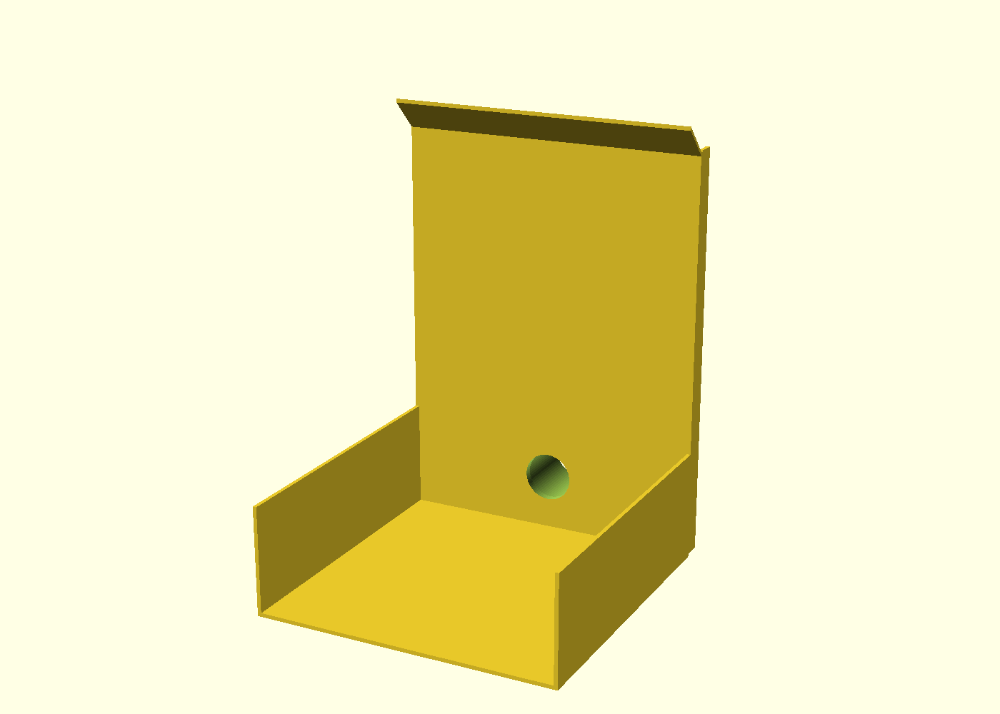
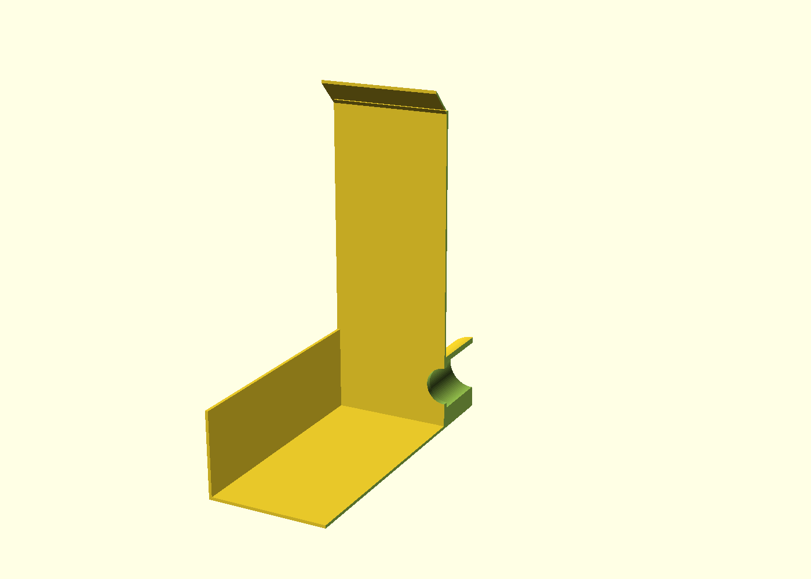

# Compact replacement candidate

Unprinted, original geometry. This replaces the user's first print of the linked MakerWorld dust collector, not an unrelated tray. The earlier eight-plate enclosure remains available as a superseded reference, not the recommended next print.

## User measurements and requirements

- Clear interior footprint: 155 mm wide by 155 mm deep.
- Belt contact: approximately 115 mm above the tabletop, approximately 125 mm behind the proposed front edge.
- Highest working tool/hand position: approximately 200 mm above the tabletop.
- Front means the opening through which the motor handle projects.
- Workpieces include long kitchen knives, a multitool, pliers, snips and other awkward shapes. Access must allow strokes and tilting, not merely insertion through a small hole.
- The existing printed collector is removed. Its thickness is not specified, so the tabletop-referenced contact height cannot be assumed to stay exactly the same after replacement. Confirm it in an unplugged dry fit.
- Aim for less than 400 g and 12 hours for the complete print, including any supports, interface changes and purge. These are acceptance targets, not estimates from CAD volume.

User photographs informed orientation only. They are not calibrated measurements, were not traced into CAD, and stay local outside the public repository.

## Candidate architecture

One connected single-wall print with a 2 mm stable floor, 2 mm walls, side walls ending at 57 mm, and a 212 mm rear wall with four external ribs. A 15 mm canopy slopes upward 45 degrees toward the front: its underside rises from 210 to 225 mm, with a 227 mm top edge. Overall bounds are 159 x 199 x 227 mm, including the integrated socket. Broad upper side access connects directly to the open front. The rear wall and canopy are still potential collision surfaces for angled or unusually long workpieces; a dry sweep test is mandatory.

The floor supports the tool rather than deliberately tipping it on a slope. One low rear outlet is accessible from inside the hood and through the socket. No liners, fasteners or sealed dust chambers are required. Socket mating dimensions remain 32.10 mm bore, 39 mm straight engagement plus a 1 mm internal mouth round, 34.10 mm mouth diameter and 39.80 mm outside diameter. The 25 mm throat remains an explicitly unvalidated restriction.

Supports must remain removable. The socket bore still needs support review. The first flat-canopy trial required full-height supports and a tall purge tower; the upward slope is intended to remove that burden without lowering tool clearance.

**Material blocker:** Bambu's [PLA/PETG mutual-support guide](https://wiki.bambulab.com/en/filament-acc/filament/h2d-pla-and-petg-mutual-support) explicitly excludes PETG Translucent. It documents PLA Basic with PETG Basic or HF, not this requested pairing. The Translucent/PLA project is an experimental estimate, not a manufacturer-supported process or print-ready release. Confirm the material-feeding setup and test a representative interface coupon before using it, or deliberately change to a documented material pair and re-slice with the appropriate P2S settings. The old 0.20 mm fit-coupon project does not validate a new 0.28 mm process.

The experimental slice uses PETG for the model/support base, PLA Basic only for interfaces, three top interface layers, zero interface spacing and zero top/bottom support Z gaps. Purging into model infill or supports is disabled. These settings alone do not validate temperatures, purge cleanliness or interface adhesion for Translucent.

## Validation and release gates

`cad/compact-hood.scad` and `exports/compact-hood.stl` are separate from the previous design. Use `make export`, `make compact-views` and `make verify` to regenerate and check them.

Geometry checks cannot establish tool fit, ventilation clearance, capture, PETG stiffness or safe use. Confirm full strokes with the sharpener unplugged, including the motor, controls, belt changes and hand clearance. Do not rely on the printed walls as guards or let them contact the moving belt.

The project remains unvalidated for metal sharpening dust, sparks or mixed metal/combustible collection with the DCV581H. Workpiece measurements are dimensional references, not authorization for that use. No print is started remotely. MakerWorld publication remains gated on physical testing and permission review.

## Observed slice, 2026-10-14

`../slicer/compact-hood-experimental-p2s.3mf` was saved, reopened and re-sliced in Bambu Studio 2.6.0.51. The result was reproduced: **11h15m total, 256.32 g**, including preparation, supports, purged filament and prime tower. There are 22 filament changes. The 0.20 mm Standard profile is modified to **0.28 mm layers**, with a 0.20 mm first layer, four wall loops and five top/bottom layers. This is not an unchanged Standard profile.

| Component | Estimated mass |
| --- | ---: |
| Model | 230.84 g |
| Supports and interfaces | 3.93 g |
| Purged filament | 12.11 g |
| Prime tower | 9.44 g |
| Total | 256.32 g |

The flat-canopy baseline took 15h33m at 0.20 mm and 14h33m at 0.28 mm. The upward-sloping canopy removes the tall support tree and allows the prime tower to finish near the socket height instead of the canopy height. The initial tower placement produced boundary and path-conflict errors; moving the model and tower apart resolved those errors in the final re-slice, rather than disabling checks. The PLA/PETG compatibility warning remains visible and unresolved.

The default color-derived flush matrix is 606 mm3 from PETG to PLA and 270 mm3 from PLA to PETG, before any applicable slicer multiplier. It has NOT been validated for Translucent contamination or layer strength. Do not treat this estimate project as printer-ready, or send it with both materials assigned to the same physical spool. Confirm material selection/mapping and a suitable purge procedure as part of the coupon trial or supported-material revision.

`make verify` passes 78 tests plus formatting, lint and type checking. The tests include watertight connected geometry, access-volume probes, exact nominal socket profile, canopy slope, invalid-input failures, experimental process settings and comparison of the saved project vertices against the current STL. The Bambu source-offset metadata can remain stale after reload; tests use the actual build transform to verify placement at z=0.

Remaining release gates: material/process decision, representative interface and hose-fit coupons at the chosen layer height, detailed toolpath/support-removal inspection, unplugged workpiece sweep and cooling/access checks, and physical capture/safety assessment. Neither the time estimate nor the geometry tests establish those outcomes.

