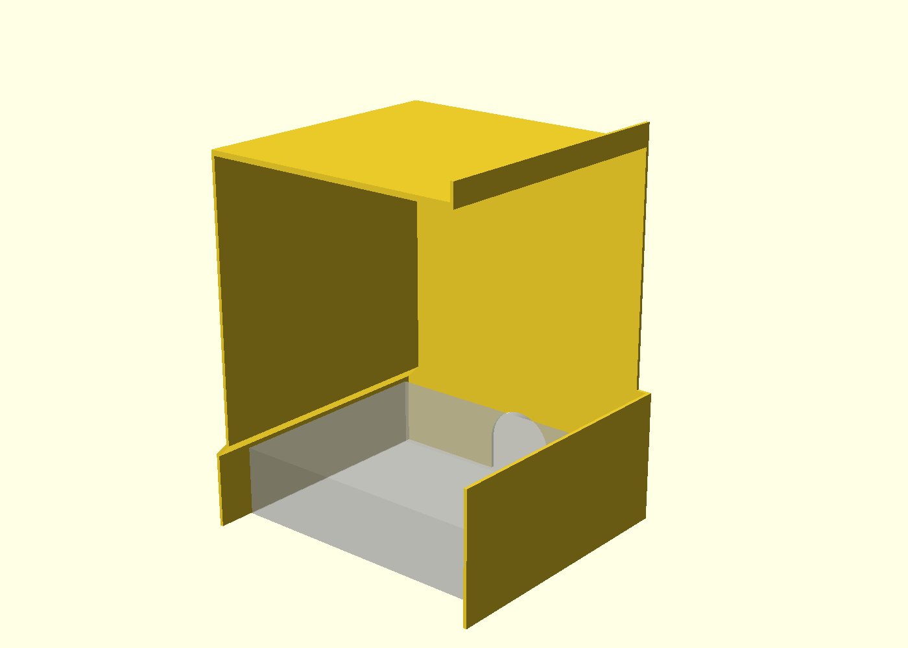
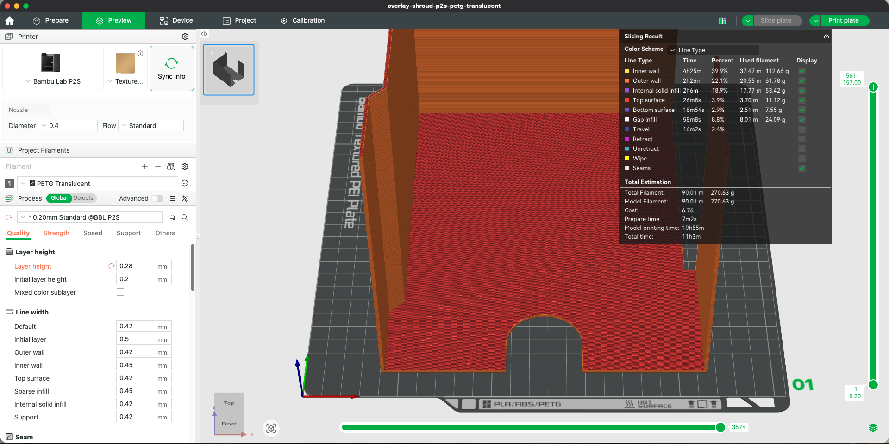
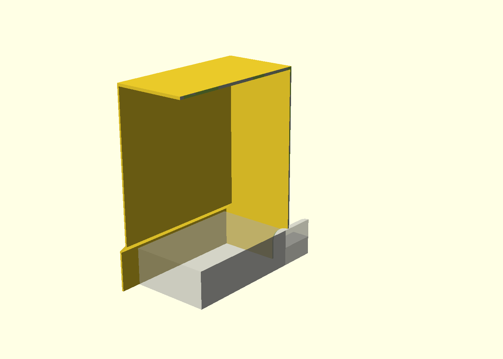

# PETG Translucent overlay shroud

Original, unprinted candidate for the user's existing collector. This is a cover only: the existing collector, suction slots and hose connection stay in use. No third-party geometry is imported or distributed. The source-derived interface measurements are in [overlay-fit.md](overlay-fit.md).

The gray object is a conservative box-and-stub clearance reference, NOT the actual collector or a printable component.

## Geometry and installation

- One printable solid, with closed roof, left and rear walls.
- Connected openings across the full-height front motor-entry face and the right tool-entry face above 75 mm. Opposite-wall workpiece clearance is deliberately not investigated, per the user's direction.
- At least 155 x 155 mm clear working footprint above the left shoulder. Roof underside is 210 mm above the table, with 10 mm clearance beyond the user's 200 mm highest working position.
- A 171.25 mm-wide base pocket surrounds the 170 mm-wide collector. The left wall steps inward above 42 mm, clearing the collector's 39.8 mm rear height. The right lower wall stays outside the collector.
- The shroud stands on the table around the collector, rather than loading its thin, non-level rim. This avoids a copied or complex contoured rim adapter. Its front projects 21.4 mm beyond the collector, with the table serving as the floor.
- Two-millimeter walls, a 3 mm roof and a 10 mm top-side roof-edge stiffening rim. Installed height including the rim is 223 mm.

The open underside requires removable compressible gasket tape along the table-contact edges. The rear wall also needs a seal against the existing hose stub: its 41 mm arch clears the nominal 39.8 mm D-shaped stub by approximately 0.6 mm per side. Foam or EPDM tape around that crossing is an assembly requirement, not a modeled or tested airtight fit. The shroud has no attachment clamps and is located by gravity/friction; displacement resistance and gasket compression are untested.

The source stub's lower half is flat-sided, not a complete circle: read-only section probes at source Y=49 give approximately 19.9 mm exterior half-width at table heights 1, 5, 10, 15 and 19.9 mm, with a circular upper half. The arch and the conservative clearance test account for this lower rectangular region. No restriction is introduced into the hose bore.

Without both the table and stub seals, the bottom and rear gaps are additional air leaks. The intended two access openings should not be described as the only airflow paths until those seals are fitted and checked.

## Printing and files

- Source: `cad/overlay-shroud.scad`.
- Manufacturing mesh: `exports/overlay-shroud.stl`, **rear-face-down**, already oriented for the bed.
- Saved Bambu project: `slicer/overlay-shroud-p2s-petg-translucent.3mf`.
- View selectors: `part="assembly"` and `part="section"`; manufacturing selector: `part="print"`.
- Rebuild with `make export overlay-views`; validate with `make verify`.

The print bounds are approximately **175.25 x 223 x 157 mm**. Rear-face-down makes the walls vertical extrusions and avoids the unsupported lower side wall that roof-down would create. There are no geometric downward-facing overhangs above the bed; the candidate is intended for single-material PETG Translucent without supports or PLA interfaces. Tall thin walls may still wobble or detach during printing. Geometry alone does not establish reliable printing.

## Saved and reopened slice, 2026-10-14

Bambu Studio 2.6.0.51 reproduced **11h03m total / 270.63 g** after reopening the saved project and re-slicing. The total includes the displayed 7m02s preparation time; model printing is displayed as 10h55m (rounded independently). There are no supports, no generated prime tower and zero filament changes. The reported total filament equals model filament; it does not independently quantify any printer startup purge outside the slicer's material accounting.

The P2S 0.4 mm / Textured PEI project uses only Bambu PETG Translucent, **0.28 mm layers**, a 0.20 mm first layer, four wall loops and five top/bottom layers. The base preset label remains `0.20mm Standard`, but the layer height is modified. Sparse infill is set to 15%; the thin geometry is largely walls and solid fill. Automatic brim is configured at 5 mm, but none appears in the resulting line-type breakdown. The global prime-tower option remains enabled, but no tower is generated for this single-filament job.

The first-layer preview shows a continuous rear-panel footprint with the hose arch open to its edge. Middle and final layers retain the continuous wall paths; the line-type breakdown contains no support or bridge category. No boundary, path-conflict or material-pairing warning was visible on the final re-slice. These sampled inspections do not establish adhesion, wall stability or complete physical printability.

The saved project contains one unrepaired printable object, with geometry matching the current STL and bed placement checked by tests. The archive's `slice_info.config` contains only a client header, so mass/time are recorded from the GUI, not asserted as machine-readable test results. The full gate passes **95 tests**, formatting, lint and type checking without warnings.

Both numerical targets (<400 g / <12 hours) are met by the reported slice. Physical fit, seals, thin-wall stability and safe capture remain unvalidated; no print has been started.

## Validation and limits

The geometry suite checks one watertight connected solid, nondegenerate faces, bed bounds, analytic collector and flattened-stub clearance, working-volume and entry-opening probes, closed walls, roof height, print overhangs, repeat export agreement and invalid wall-thickness rejection. It does not validate printed tolerances, gasket leakage, stability, stiffness, tool fit or dust capture.

Use only as an unvalidated cold nonmetal-dust prototype. No approval for hot particles, metal sharpening dust, sparks or mixed combustible/metal collection with the DCV581H. Physical dry fitting and safe-use evaluation remain required. No print was started remotely.

