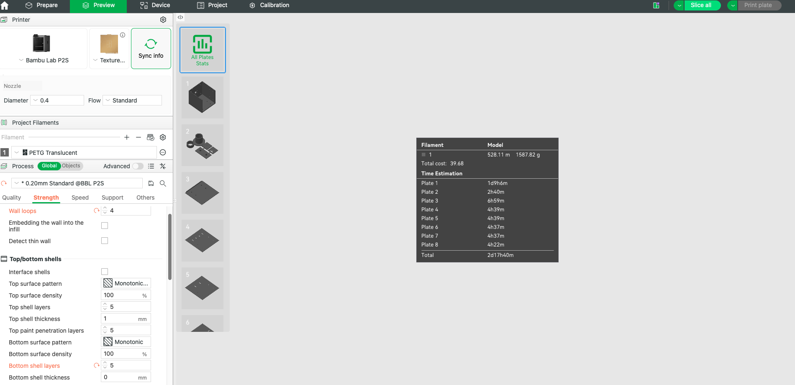

# Slicing progress

Unprinted prototype. These are observations from Bambu Studio 2.6.0.51, not a manufacturing release or physical validation. No print has been started.

Profiles: Bambu Lab P2S 0.4 nozzle, Bambu PETG Translucent, 0.20 mm Standard, Textured PEI Plate, four walls and five top/bottom layers.

`../slicer/dust-hood-p2s-petg-translucent.3mf` contains ten objects on eight plates, including both side liners. It was saved, reopened and all eight plates re-sliced. The same total estimate was reproduced: **2d17h40m, 1587.82 g**. No warning was visible in the final all-plates summary or tub preview. This does not replace detailed layer inspection of every plate.

| Plate | Contents | GUI time estimate |
| --- | --- | --- |
| 1 | Tub, floor down | 1d9h6m |
| 2 | Adapter, fit coupon, joint coupon | 2h40m |
| 3 | Roof, exterior face down | 6h59m |
| 4 | Floor liner | 4h39m |
| 5 | Roof liner | 4h39m |
| 6 | Side liner | 4h37m |
| 7 | Second side liner | 4h37m |
| 8 | Rear liner | 4h22m |

The tub accounts for 799.05 g; the roof for 170.51 g. Print coupons first, not the entire project. The separate coupon-only project estimates 1h23m and 28.87 g; do not print duplicate coupons from both projects unless needed.

The initial overlapping coupon import produced a G-code path conflict. Arranging the two objects separately and re-slicing removed the warning. The tub initially imported outside its plate; arranging it onto its own plate removed the bounds error. Neither warning was suppressed.

Saved `.3mf` files are editable Bambu projects, not printer-ready G-code archives. The settings template is empty. Automated tests check the agreed profiles, complete object inventory, unique plate assignment, and zero reported mesh repairs in the full project.

Still required before a manufacturing release:

- Inspect first layers, nut-pocket bridges, gusset transitions, socket mouth, all inlet slots and final layers at useful zoom and line-type colors. A successful slice alone is insufficient.
- Review brim requirements and the adhesion/warping risk of the near-bed-sized PETG parts. Nominal bed fit alone does not prove adhesion.
- Confirm every plate's warnings individually and record the final inspection evidence. Full warning-free release status is not claimed yet.
- Print/test coupons, then assess enclosure fit, sealing, cleaning and capture using `testing.md`.

Detailed GUI inspection was interrupted by a macOS screen-capture permission prompt for Ghostty. That permission was not granted automatically.
